# Unity NAI · GPT Skills

Claude Code에서 게임 아트를 뽑고 게임 안에서 확인할 때 쓰는 공용 스킬 네 개. 프로젝트에 묶이지 않게 일반화해 둠.

| 스킬 | 하는 일 |
|---|---|
| `nai-image` | NovelAI Diffusion V5로 일러스트 · 배경 · 소품 · 스프라이트 생성. 투명 PNG, 캐릭터별 캡션, 타일링 지원 |
| `codex-art-request` | 로컬 Codex 앱(GPT 이미지)으로 UI · VFX · 스프라이트를 목업 → 분절 두 단계로 받아 옴 |
| `fx-sheet` | 캐릭터 공격 프레임에 맞물리는 연속 프레임 이펙트 시트(휘두르기 궤적 · 타격 섬광 · 먼지 · 피탄)를 Codex로 그려 게임용으로 자름 |
| `unity-play-record` | Unity 플레이 모드에서 한 장면(대기 · 공격 · 이펙트)을 30fps로 녹화해 mp4로 만듦. 이미지를 읽지 않아 하이쿠에게 맡길 수 있음 |

## 이 스킬로 만든 것

### Dusk Princess and Twilight Prince ([AIGameHackaton](https://github.com/digital8150/AIGameHackaton))

AI 게임 해커톤 출품작. 2D 플랫포머 퍼즐. **게임 안의 그림은 전부 이 스킬들로 만들었음**: 타이틀, 캐릭터 초상, 그림책 컷신, 원경 · 중경 · 전경 레이어, 스테이지 소품, UI.

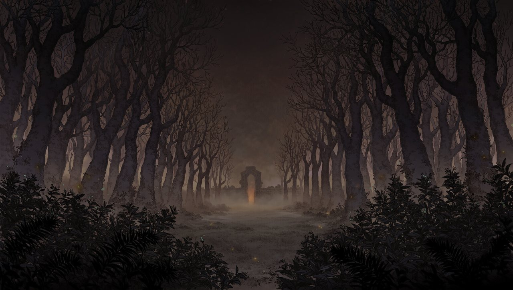

| 공주 초상 | 왕자 초상 |
|---|---|
|  | 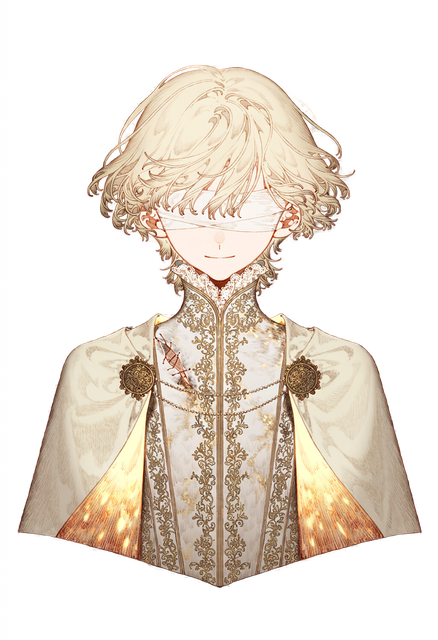 |

| 그림책 프롤로그 | 그림책 에필로그 |
|---|---|
|  | 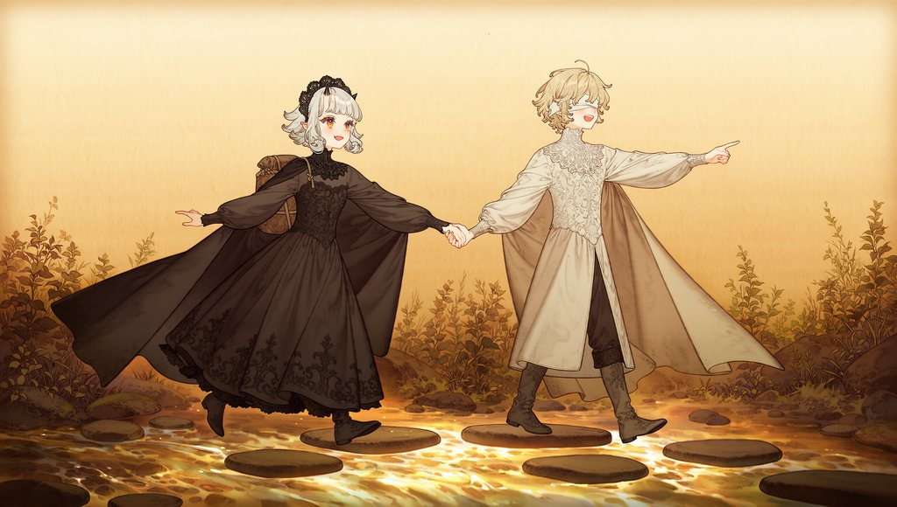 |

| 감각 전환 (원경 · 중경 · 전경 레이어) | 메아리로 드러나는 숨은 발판 |
|---|---|
| 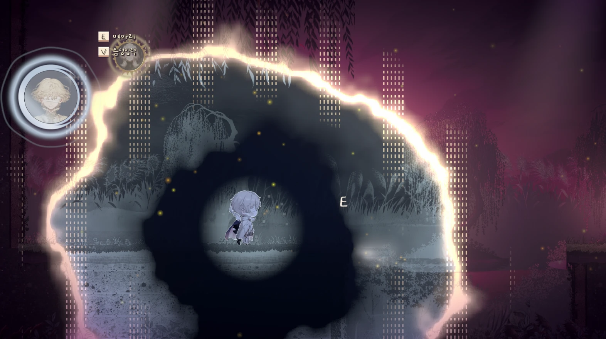 | 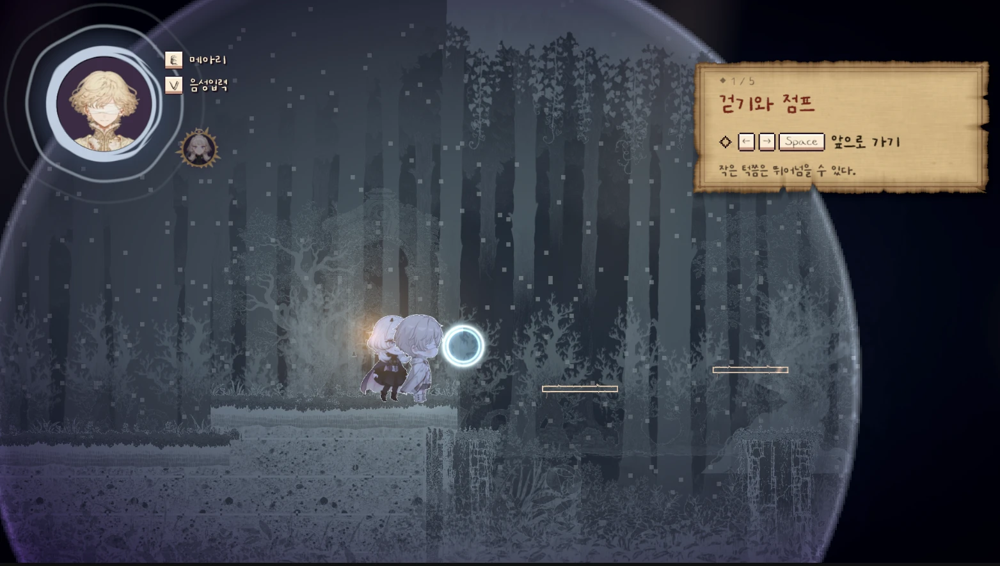 |
| 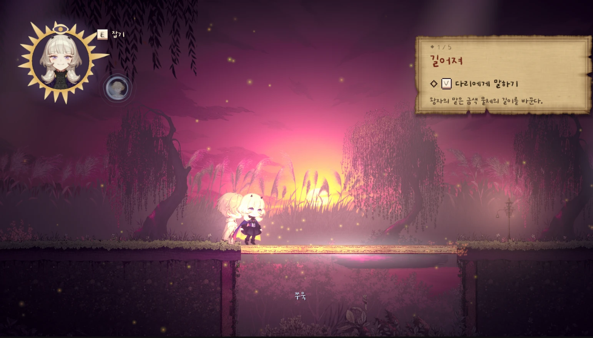 | 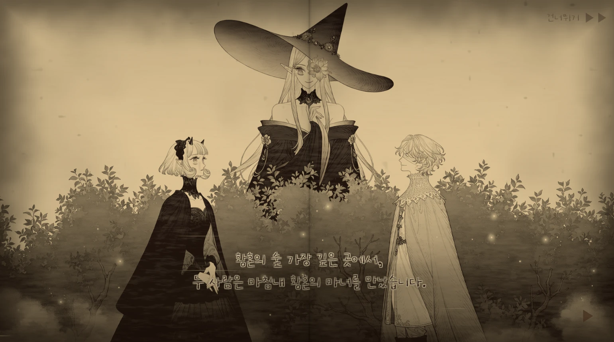 |

### Project-Vertex

아니메풍 디스토피아 덱빌딩 로그라이크 (졸업 작품). 배경 · 캐릭터는 NAI, 화면 UI · 전투 이펙트는 GPT 목업 → 분절.

| 로비 | 무기고 |
|---|---|
| 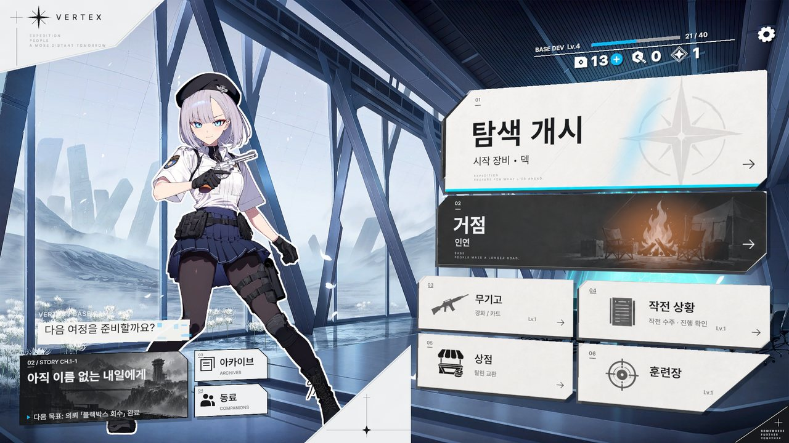 | 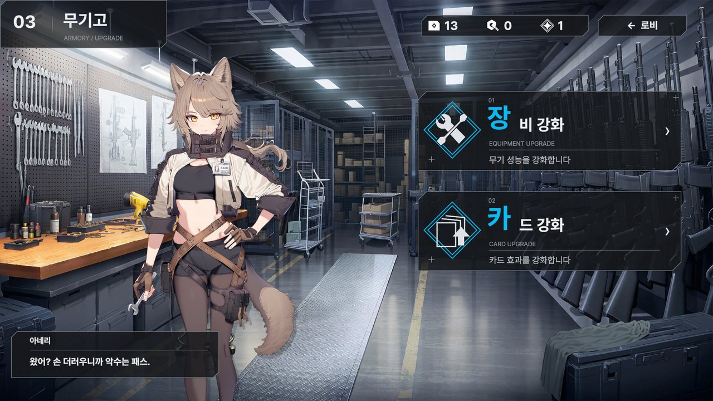 |
| 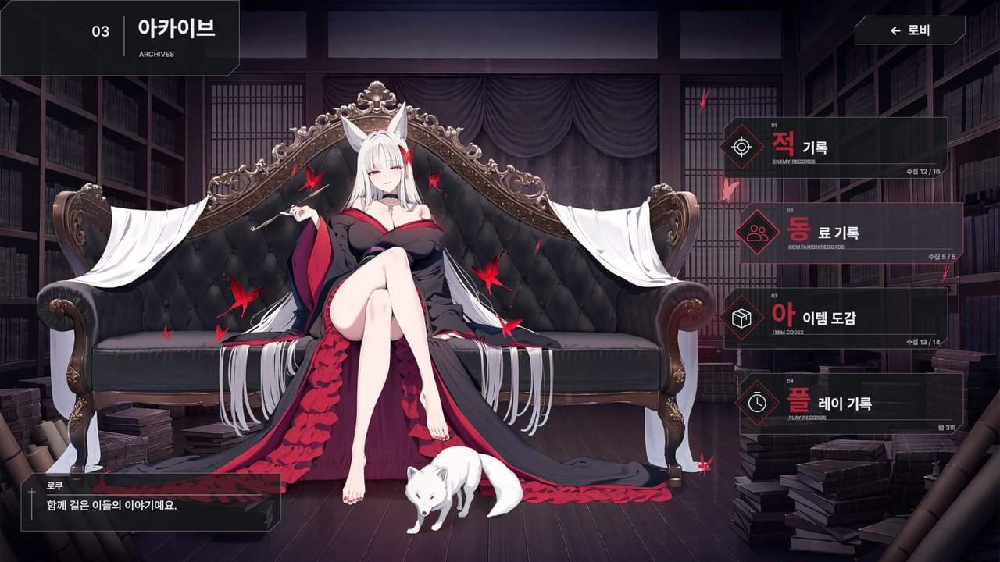 | 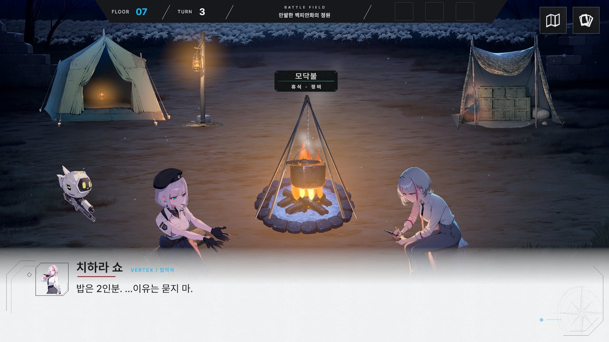 |

**GPT 목업 → 게임 적용** (작전 상황 화면, 요청서는 `examples/gpt-vertex/OperationStatus/`)

| 목업 (`REQUEST.md`) | 분절 조각으로 조립한 실제 게임 화면 |
|---|---|
| 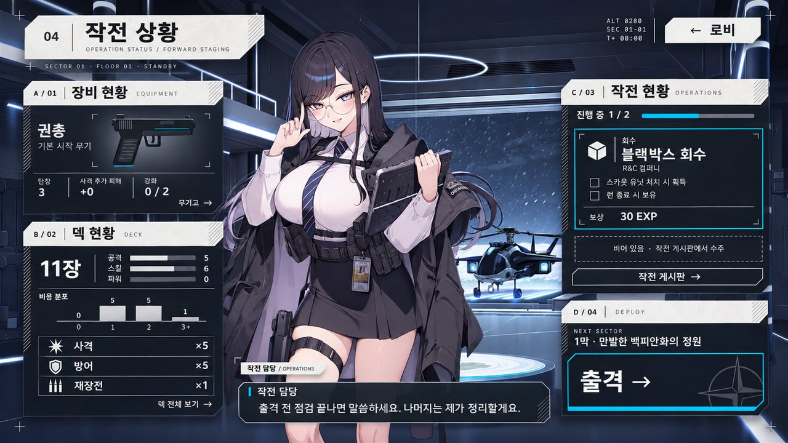 | 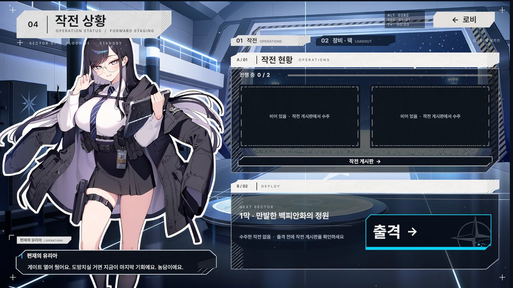 |

**전투 이펙트 시트** (`fx-sheet`, 요청서는 `examples/gpt-vertex/FxSheet/`)

캐릭터의 실제 공격 프레임을 같은 격자에 깐 가이드를 같이 보내면, Codex가 무기 끝을 따라가는 12프레임 이펙트를 그림. 앞 몇 장은 공격 시트와 1:1로, 뒤의 먼지 · 잔상은 절반 속도로 재생해서 "식 하고 사라지는" 느낌이 없어짐.

| 방망이 내려치기 (가이드 위에 겹쳐 본 것) | 게임 화면 |
|---|---|
| 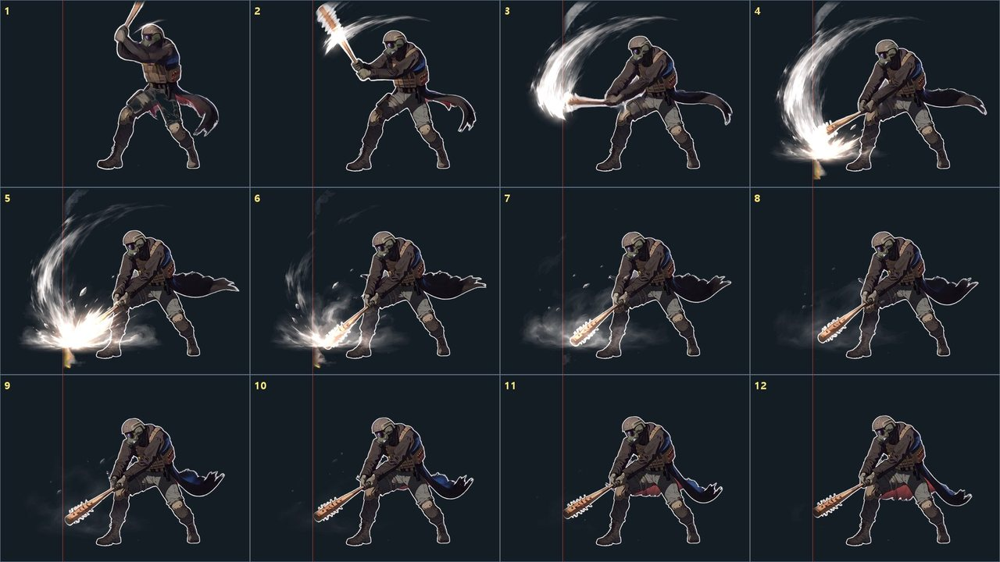 | 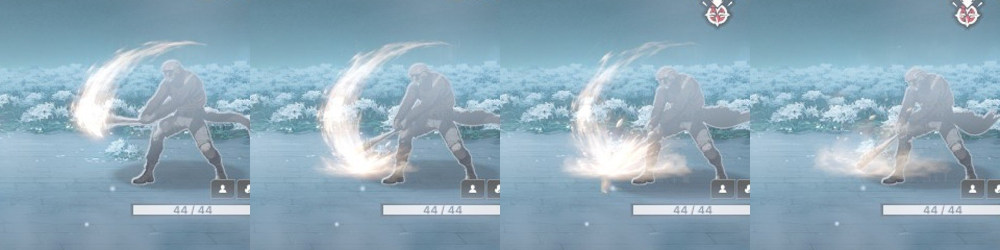 |
| 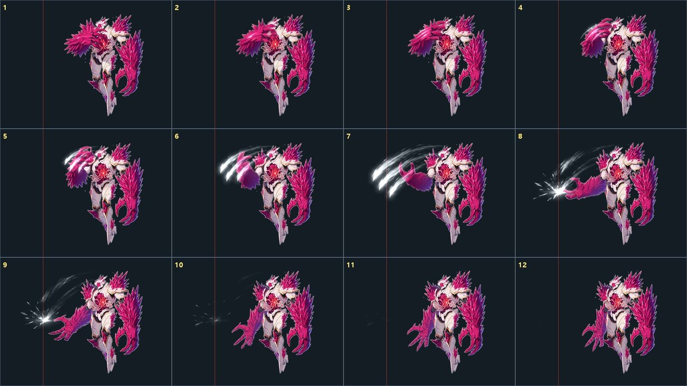 | 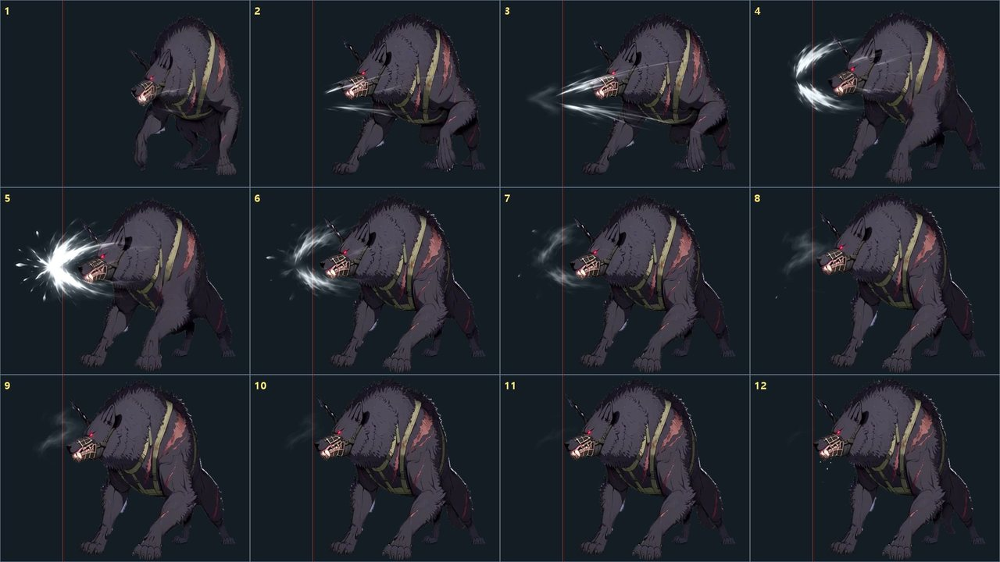 |

공용 피탄 이펙트 (사격 적 7종이 같이 씀, 흰색으로 그리고 게임에서 색을 곱함)


**VFX 목업** (총구 섬광, 요청서는 `examples/gpt-vertex/MuzzleFlash/`)

| 전투 장면 목업 | 섬광 변형 |
|---|---|
| 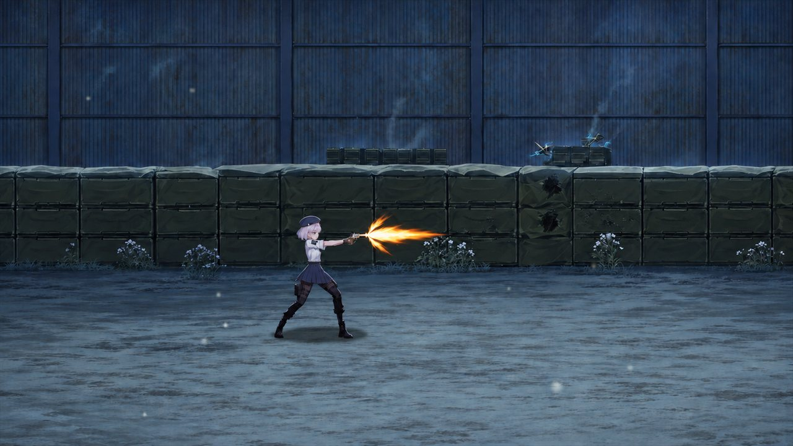 |  |

## 설치 (새 PC / 노트북)

1. 이 저장소를 사용자 스킬 폴더에 받음.
   - `~/.claude/skills`가 비어 있으면 그 자리에 바로 clone:
     ```
     git clone https://github.com/SkylightStudio07/Unity-NAI-GPT-Skills.git "%USERPROFILE%\.claude\skills"
     ```
   - 이미 다른 스킬이 있으면 아무 데나 clone한 뒤 `nai-image`, `codex-art-request`, `fx-sheet`, `unity-play-record` 폴더만 `~/.claude/skills/`로 복사함.
   - 한 프로젝트에서만 쓸 거면 그 프로젝트의 `.claude/skills/`에 넣어도 됨.
2. Python 3와 Pillow 설치: `pip install pillow` (`fx-sheet`는 numpy도: `pip install numpy`)
3. `unity-play-record`는 Unity CLI(`unity command`)가 열린 Editor에 연결돼 있어야 하고, Git Bash에서 실행함.
4. Claude Code를 다시 열면 스킬 목록에 네 개가 보임.

## 인증 (저장소에 절대 넣지 않음)

- **NAI:** Windows 사용자 환경 변수 `NAI_API_KEY`에 NovelAI 토큰을 등록함 (시스템 속성 → 환경 변수 → 사용자 변수). 채팅에 붙여 넣지 않음.
- **GPT (Codex):** Codex 앱을 설치하고 로그인함. 스크립트는 앱 안의 `codex.exe`를 자동으로 찾음.
- 확인:
  ```
  python -I ~/.claude/skills/codex-art-request/scripts/run_codex_art.py --check
  python -I ~/.claude/skills/nai-image/scripts/nai_gen.py --prompt "no humans, game asset, wooden crate" --name test --dry-run
  ```

## 새 프로젝트에서 NAI 쓰기

프로젝트 루트에 `Art Prompts/` 폴더를 만들고 아래 파일을 둠 (자세한 형식은 `nai-image/SKILL.md`).

- `[Base Prompts].txt`: 모든 프롬프트 뒤에 붙는 공통 화풍 (작가 · 품질 태그)
- `[Negative Prompts].txt`: 네거티브
- `[Props] 01_Name.txt` 등: `## 1. 제목 (16:9)` / `### 1-A. 항목` 섹션 하나가 프롬프트 하나 → 키 `01:1-A`

화풍은 첫날 몇 장 뽑아 보고 `[Base Prompts].txt`에 고정해 두는 게 좋음. 그 뒤로는 에셋마다 화풍 단어를 따로 넣지 않음.

## 참고 자료 (`examples/`)

두 프로젝트에서 실제로 쓴 파일. 새 프로젝트를 시작할 때 형식을 그대로 베껴 쓰면 됨.

- **Project-Vertex**: 아니메풍 디스토피아 덱빌딩 로그라이크 (Unity, uGUI)
- **AIGameHackaton** (Dusk Princess and Twilight Prince): 세피아 동화책풍 2D 플랫포머 퍼즐 (Unity)

| 경로 | 내용 |
|---|---|
| `examples/NAI_V5_Prompt_Guide.md` | NAI V5 문법 정리 (태그 + 자연어 배치, `{}` · `숫자::태그::` 가중치, `Text:` 글자 넣기, 눈매 고정). 5장은 Vertex 폴더 기준 |
| `examples/nai-hackathon/` | `nai-image`가 그대로 읽는 섹션 형식의 완성 예. 화풍(Base) · 네거티브, 스테이지 소품(`03`), 원경 · 중경 · 전경 레이어와 UI(`04`), 캐릭터 둘이 나오는 그림책 장면(`07`, `@char` 사용) |
| `examples/nai-vertex/` | Vertex 화풍(작가 배합) · 네거티브, 방 배경 한 장 파일(왼쪽 · 가운데 · 오른쪽 구역 블록 방식), 거점 소품 섹션 파일 |
| `examples/gpt-vertex/UI_Mockup_Split_Workflow.md` | 목업 → 분절 방식의 원본 문서 (`codex-art-request/references/workflow.md`는 이걸 일반화한 것) |
| `examples/gpt-vertex/OperationStatus/` | UI 화면 하나의 `REQUEST.md` + `SPLIT_REQUEST.md` 짝 |
| `examples/gpt-vertex/MuzzleFlash/` | VFX(총구 섬광 · 연기)의 `REQUEST.md` + `SPLIT_REQUEST.md` 짝. 게임에서 어떻게 재생되는지부터 적는 예 |
| `examples/gpt-vertex/FxSheet/` | 연속 프레임 이펙트 요청서 넷: 방망이 휘두르기(근접 무기), 결정 발톱(세 줄 궤적 + 파편), 돌진 물기, 공용 피탄. 가이드 읽는 법 · 칸별 표 · 재생 방식 쓰는 예 |
| `examples/vertex-play-record/battle_scenario.cs` | `unity-play-record`용 시나리오 완성 예: 조우 에셋으로 전투 시작 → 대기 녹화 → 적이 공격할 때까지 턴 넘김 → 공격 녹화 |
| `examples/gpt-hackathon/HUD_TopLeft_request.md` | 한 장짜리 UI 요청서. 교체 가능한 고리 + 초상처럼 "게임이 어떻게 조립하는지"를 규격으로 적는 예 |

요청서가 가리키는 `Reference/` 이미지와 결과 PNG는 저장소에 넣지 않았음 (문서 형식만 참고).

### 두 프로젝트에서 얻은 요령

**NAI**
- 화풍은 `[Base Prompts].txt` 하나에만 둠. 에셋마다 화풍 단어를 더하면 금방 톤이 갈라짐.
- 같은 인물은 외형 줄을 모든 파일에 글자 그대로 복사함 (서 있는 그림 · 전투 · 컷인 · 치비).
- 투명 소품은 `{{black background, simple background}}` + "isolated on a solid black background" → 스크립트가 알파 PNG로 바꿈. 소품은 한 프롬프트에 하나씩.
- 2.5D 배경은 한 장으로 그리지 않고 뒷벽 · 중간 소품 · 앞 레이어로 나눠 뽑고, 모든 레이어에 같은 조명을 적음 (`nai-image/references/environment-2_5d.md`).
- `Base`의 `1girl`은 남캐 · 메카 · 소품을 뽑을 때 바꾸거나 빼야 함.
- 마음에 든 그림은 섹션 키 + 시드를 기록해 둠. 같은 시드 + 같은 JSON이면 같은 그림이 나옴.

**GPT (Codex)**
- 요청서에는 "이게 게임에서 어떻게 쓰이는지"(크기, 교체되는 부분, 재생 방식, 기준점)를 먼저 적음. 그게 그려야 할 것을 정함.
- 목업과 분절은 반드시 따로. 분절 전에 목업의 실제 크기를 재고 조각 표를 씀.
- 글자는 그림에 넣지 않고 게임이 그림. 상태(기본 · 호버 · 선택)는 같은 장면에서 상태만 바꿔 그리게 함.
- 받은 조각은 직접 열어 크기 · 테두리 알파를 확인함. 납품된 README나 검증 JSON만 믿지 않음.
- 연속 프레임 이펙트는 캐릭터 공격 프레임을 깐 가이드를 같이 보내면 위치가 맞게 나옴. 게임에서 어긋나 보이면 그림보다 배치 사각형(`preserveAspect` 이미지는 상자보다 작게 그려짐)을 먼저 의심함.
- 이미지 모델은 사라지는 꼬리 프레임을 너무 어둡게 그림. 자를 때 뒤쪽 프레임 밝기를 올림 (`fx-sheet/scripts/cut_fx.py --gain`).

**게임 안 확인**
- 녹화 · 영상 변환은 토큰을 거의 안 씀. 이미지를 열어 보는 게 비쌈. 녹화는 하이쿠에게 스크립트 한 줄로 맡기고, 메인 세션은 영상만 사용자에게 전달함.

## 지키는 것

- 토큰 · `~/.codex/auth.json`은 읽지도 출력하지도 않음.
- NAI는 무료 범위(≤1024×1024, ≤28 step, 1장씩)만 씀. 넘으면 스크립트가 경고함.
- 실존 IP · 실존 인물 태그 금지.
- 생성물 폴더(`_nai_out/`)와 Codex 작업 파일(`_codex_*.txt`, `Working/`, `.py` · `.cjs` · `.ps1`)은 게임 프로젝트에 커밋하지 않음.
